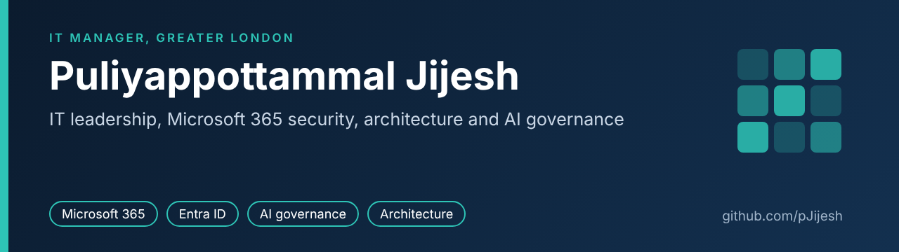

  IT Manager in Greater London 
  IT leadership, Microsoft 365 security and AI governance

  
  

---

I run IT for a mid-sized organisation and have spent more than 15 years in service management, infrastructure, security and project delivery. These repositories are the practical side of that work: small, tested tools and templates for the jobs an IT manager actually has to do, written so that someone else can pick them up and use them.

Every example uses fictional data. Each repository says plainly what has and has not been verified.

## Repositories

### AI governance

| Repository | What it is | Tests |
|---|---|---|
| [ai-governance-toolkit](https://github.com/pJijesh/ai-governance-toolkit) | Control matrix mapping ISO/IEC 42001, the EU AI Act and NIST AI RMF, with templates, worked examples and a validator |  |
| [eu-ai-act-risk-classifier](https://github.com/pJijesh/eu-ai-act-risk-classifier) | Answer a short questionnaire and get your EU AI Act risk tier, obligations and key dates |  |

### Identity and endpoint security

| Repository | What it is | Tests |
|---|---|---|
| [m365-entra-security-audit](https://github.com/pJijesh/m365-entra-security-audit) | Read-only PowerShell module that audits Microsoft 365 and Entra ID: MFA, stale accounts, privileged roles, guests and Conditional Access |  |
| [intune-endpoint-baseline](https://github.com/pJijesh/intune-endpoint-baseline) | Windows and macOS endpoint security baseline for Microsoft Intune: written standard, policies, safe import script and linter |  |
| [joiner-mover-leaver-automation](https://github.com/pJijesh/joiner-mover-leaver-automation) | PowerShell and Microsoft Graph automation for joiners, movers and leavers, with dry-run by default and an audit log |  |
| [access-rationalisation-toolkit](https://github.com/pJijesh/access-rationalisation-toolkit) | Analyse legacy access groups, propose a smaller role model, and flag segregation-of-duties conflicts |  |
| [cyber-essentials-plus-iso27001-readiness](https://github.com/pJijesh/cyber-essentials-plus-iso27001-readiness) | Cyber Essentials checklist mapped to all 93 ISO/IEC 27001 Annex A controls, with a tool that tracks evidence and drafts a Statement of Applicability |  |
| [incident-response-and-dr-playbooks](https://github.com/pJijesh/incident-response-and-dr-playbooks) | UK-focused incident response and disaster recovery playbooks, templates and a tabletop exercise for small IT teams |  |

### IT leadership and operations

| Repository | What it is | Tests |
|---|---|---|
| [it-leadership-toolkit](https://github.com/pJijesh/it-leadership-toolkit) | Board report, KPI pack, vendor scorecard, budget tracker and service review templates, with worked examples |  |
| [it-manager-day-planner](https://github.com/pJijesh/it-manager-day-planner) | Day and week planner for IT managers: an operating rhythm, printable templates and a time-blocked plan builder |  |
| [it-service-reporting-sql-powerbi](https://github.com/pJijesh/it-service-reporting-sql-powerbi) | Tickets to board pack for IT service reporting: SQL views, a monthly report with charts, and a documented Power BI design |  |

### Architecture, change and integration

| Repository | What it is | Tests |
|---|---|---|
| [sovereign-stack-reference-architecture](https://github.com/pJijesh/sovereign-stack-reference-architecture) | Vendor-neutral reference architecture for keeping control of identity, data, AI and integration |  |
| [azure-cloud-migration-planner](https://github.com/pJijesh/azure-cloud-migration-planner) | Rule-based Azure migration planner: dispositions, dependency-driven waves and a three year cost comparison |  |
| [erp-consolidation-toolkit](https://github.com/pJijesh/erp-consolidation-toolkit) | Decision framework and tool for consolidating ERP systems across a group |  |
| [it-due-diligence-and-integration-playbook](https://github.com/pJijesh/it-due-diligence-and-integration-playbook) | IT due diligence and first 100 days integration playbook with a weighted question bank and scoring tool |  |
| [cargowise-integration-patterns](https://github.com/pJijesh/cargowise-integration-patterns) | Independent reference for freight ERP integration: idempotency, retries and a dead-letter queue, with a working demo |  |

## Tools and areas

-2E7D32)

## Credentials and education

- **Education:** MSc Networks and Computer System Security, University of Greenwich; BSc Computer Science, University of Kerala
- **Cloud and data:** Databricks Platform Architect (AWS, Azure, GCP) and Generative AI Fundamentals; Microsoft Azure AI Fundamentals; Boomi Associate Integration Architect
- **Governance and compliance:** ISO/IEC 42001 AI governance training (CPD); GDPR Data Protection Officer, University of Derby; Microsoft Purview compliance (Applied Skills); CSCMP Generative AI for Supply Chain
- **Service and delivery:** ITIL Foundation; PRINCE2; PMI Agile Foundations; BCS Business Analysis Foundation
- **Infrastructure and security:** CompTIA Network+; Red Hat Certified Engineer (RHCE); CNSS Certified Network Security Specialist
- **Author:** *The AI Governance Playbook*

## Get in touch

The quickest route is [LinkedIn](https://www.linkedin.com/in/pjijesh). Corrections to anything in these repositories are welcome as an issue or a pull request.
